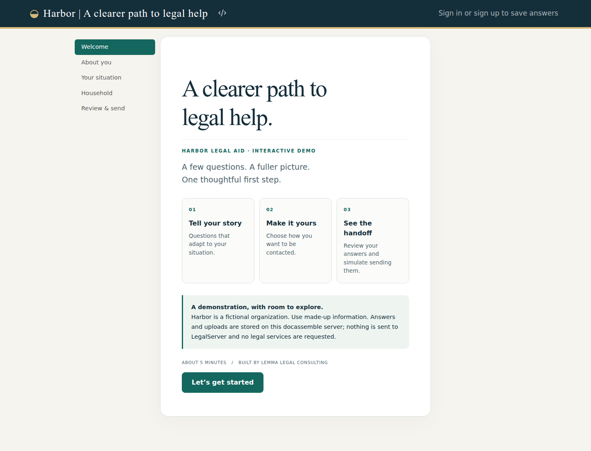

# Harbor intake demo

A fictional legal aid intake built with docassemble by Lemma Legal Consulting. Harbor pairs a warm paper, navy, teal, and brass identity with a working intake flow and an entirely offline LegalServer handoff simulation.

[Screenshot gallery and blog notes](https://gist.github.com/nonprofittechy/1bc423562cf3c299a53a51011bb73ef9) · [Local demo](http://localhost/interview?i=docassemble.HarborIntakeDemo:data/questions/intake.yml)



## Run it

Install this repository through docassemble's package manager, then open:

`/interview?i=docassemble.HarborIntakeDemo:data/questions/intake.yml`

For a configured local development server:

```sh
dainstall --server localhost .
```

No API keys, external fonts, AssemblyLine installation, or LegalServer account are needed. Use fictional information: docassemble stores interview sessions and uploaded files according to the host server's configuration.

## What to explore

- A responsive visual identity applied with interview-specific CSS.
- Section navigation, progress, and back buttons.
- Contact preferences with conditional email/phone fields and safe-contact instructions.
- A housing branch that appears only for housing issues.
- Free-text narrative, conditional deadline collection, and deadline-based routing.
- Validated household size and currency input; no eligibility determination.
- Optional multiple-file upload.
- Editable review screen, explicit simulation consent, and a downloadable JSON receipt.
- A deterministic demo reference derived from the payload, so identical answers produce the same reference.

Language preference records a desired interpreter language; it does not translate the interview. The fictional organization does not provide legal services.

## The LegalServer boundary

`handoff.py` maps the answers entered in the interview into a **demo-owned schema**, then simulates acceptance locally. There is no HTTP client, credential lookup, live endpoint, or switch that can send to a real service. Uploaded file names appear in the payload; file bytes stay in docassemble. Inactive housing and contact fields are excluded after review edits.

This is an illustration of an integration boundary, not a claim that the JSON is a universal LegalServer API contract. A production adapter needs site-specific lookup IDs, custom field mapping, authentication, consent and retention decisions, attachment transfer, timeout/retry handling, and durable idempotency. The deterministic demo reference is not a persistent delivery ledger.

## Tests and screenshots

```sh
python -m unittest discover -s tests -v
PLAYWRIGHT_PATH=/path/to/node_modules/playwright node scripts/capture.cjs
```

The browser script drives the real localhost interview with fictional data, uploads a fictional notice, checks receipt values and mobile overflow, and captures screenshots in `docs/screenshots/`. Set `DEMO_URL` for a different docassemble host. Screenshots are committed so a companion gist can embed stable image URLs (GitHub's gist API accepts text, not binary image uploads).

## Inspiration

Original implementation informed by patterns in the checked-out `docassemble-IntakeAndReuse` (intake flow), `docassemble-MOHUDEvictionProject` (branching and sections), and `docassemble-SLSCT` / `docassemble-WorkflowDocs` (LegalServer integration boundaries). No real client data or credentials are copied from those projects.

Docassemble references: [navigation and features](https://docassemble.org/docs/initial.html), [interface customization](https://docassemble.org/docs/ui.html), and [question blocks](https://docassemble.org/docs/questions.html).
